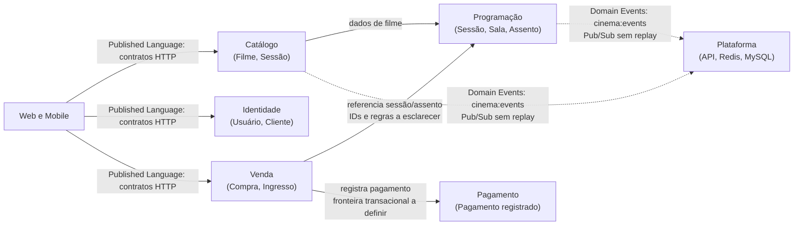

# Context Map e modelo DDD inicial

## Escopo e nível de confiança

Este é um mapa **conceitual inicial** derivado de rotas, controllers, Sequelize
models e tabelas existentes. Não há módulos DDD isolados no código: a API é
atualmente um monólito, e as fronteiras abaixo são propostas para orientar
conversas e evolução incremental. Validar linguagem, regras e ownership com o PO
e especialistas do negócio antes de afirmar que os limites estão aprovados.

## Domínios e subdomínios

| Domínio | Classificação | Subdomínios/capacidades observados |
|---|---|---|
| Operação de cinema | Core candidato | Programação de filmes e sessões; alocação de salas e assentos. É candidato a core porque diferencia a oferta do cinema, sujeito à confirmação do negócio. |
| Venda de ingressos | Core candidato | Compra, ingresso, seleção de assento e consulta de compras. Regras de concorrência, reserva e cancelamento precisam de confirmação. |
| Pagamento | Core ou apoio (decisão pendente) | Registro de método/valor associado ao ingresso. O modelo atual não demonstra integração com adquirente/provedor nem ciclo de autorização/estorno. |
| Identidade e acesso | Supporting | Cadastro/login, perfil, papéis de cliente, funcionário e administrador. |
| Catálogo e descoberta | Supporting | Consulta de filmes, sessões e assentos para os clientes web/mobile; cache Redis do catálogo. |
| Plataforma/observabilidade | Generic | API, persistência, cache, eventos, proxy, logs e deployment. |

## Context Map proposto

As setas descrevem dependências conceituais, não integração externa ou
autonomia já implementada. Hoje os modelos estão no mesmo Sequelize/MySQL e as
rotas/controllers compartilham o processo; Pub/Sub é usado para eventos
observáveis, mas não é uma garantia transacional entre banco e broker.

## Bounded Contexts candidatos

### 1. Catálogo e Programação

Responsabilidade: publicar a oferta de filmes e suas sessões/horários. Sala e
assentos são recursos de programação. Rotas atuais incluem `/catalogo/filmes`,
`/catalogo/sessoes`, `/catalogo/assentos` e CRUD administrativo de filmes,
sessões e salas.

### 2. Identidade e Perfil

Responsabilidade: autenticar usuários, aplicar papéis e manter dados do cliente.
Rotas atuais incluem `/auth/login`, `/users`, `/usuarios`, `/clientes` e
`/clientes/me`. `User` e `Cliente` são tabelas distintas; a regra que conecta
uma conta a um cadastro de cliente usa email nos controllers e deve ser
confirmada como identidade de domínio.

### 3. Venda de Ingressos

Responsabilidade candidata: reservar/confirmar assento para uma sessão, criar
ingresso e expor compras do próprio cliente. Há controllers de ingresso e
compras, mas a semântica de reserva, expiração e concorrência não está
explicitada no modelo.

### 4. Registro de Pagamento

Responsabilidade candidata: registrar valor/método e estado do pagamento para
um ingresso. O modelo atual guarda valor, método e data; estados, gateway,
idempotência, estorno e reconciliação não foram identificados. Não confundir
registro local com processamento financeiro real.

## Entities, Value Objects e Aggregates: Venda de Ingressos

Esta classificação é uma proposta de modelagem, não implementação já existente.

| Conceito | Tipo proposto | Identidade / invariantes |
|---|---|---|
| `Ingresso` | Entity e raiz de Aggregate (candidato) | Identidade `id_ingresso`; associa uma sessão, cliente e assento. Só confirmar se IDs existem e o assento está disponível para aquela sessão. |
| `Sessao` | Entity pertencente ao contexto Programação | `id_sessao`; horário, filme, sala e preço publicado. Venda deve referenciar a programação vigente; políticas de alteração após venda precisam ser definidas. |
| `Assento` | Entity/recurso de Programação | `id_assento`, sala, fila e número; não deve ter duas vendas confirmadas concorrentes para a mesma sessão. A chave de unicidade adequada é decisão de negócio/modelagem ainda pendente. |
| `Cliente` | Entity do contexto Identidade | `id_cliente`; cadastro/identidade do comprador. Venda guarda referência, não deve copiar dados pessoais indiscriminadamente. |
| `Dinheiro` (`Money`) | Value Object recomendado | Valor decimal com moeda explícita e regras de arredondamento; o banco atual guarda `DECIMAL(6,2)` sem moeda. |
| `AssentoNaSessao` | Value Object/referência composta recomendada | Par imutável `(id_sessao, id_assento)` que identifica a unidade vendável; aplicação deve validar que o assento pertence à sala da sessão. |
| `Pagamento` | Entity e possível Aggregate separado | Identidade `id_pagamento`; referência ao ingresso, valor, método e data. Separar Aggregate se ciclo de autorização/estorno evoluir de forma independente. |

### Limites e consistência propostos

- O Aggregate `Ingresso` deve proteger a invariável de disponibilidade do
  assento para uma sessão. A exclusividade precisa ser garantida
  transacionalmente no banco, não apenas por verificação anterior na API.
- Venda e pagamento podem precisar de transação ou saga conforme a integração
  real e os estados de pagamento. O repositório atual não demonstra essa
  orquestração completa.
- IDs atravessando contextos formam referências; não compartilhar objetos ORM
  como contrato público.
- Pub/Sub Redis não é outbox: queda entre commit MySQL e `PUBLISH` pode perder
  evento. Se o evento se tornar requisito de consistência, considerar outbox +
  consumer idempotente e transporte durável.
